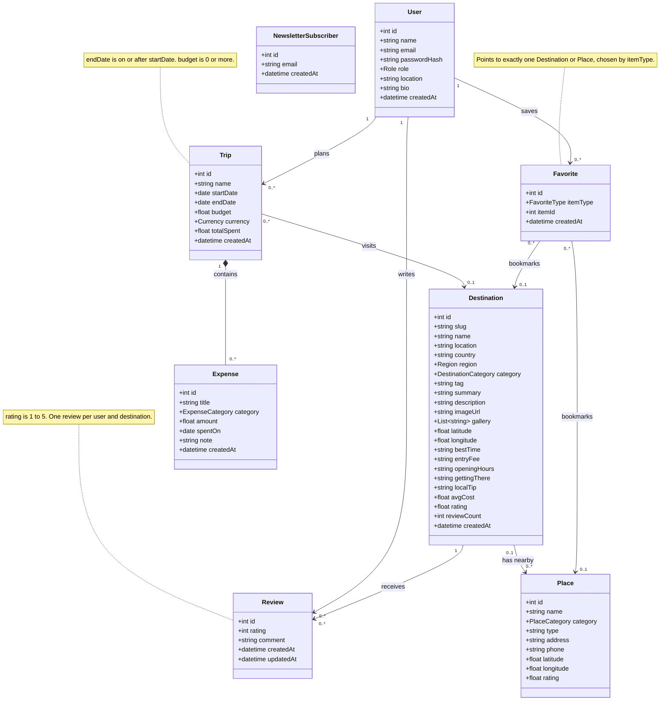
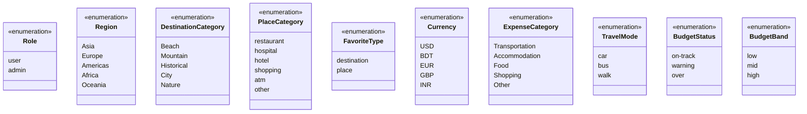
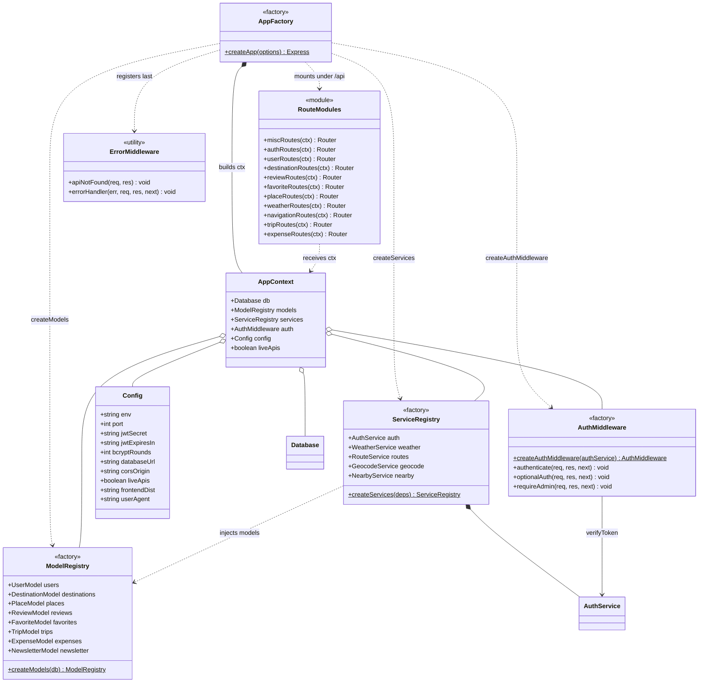
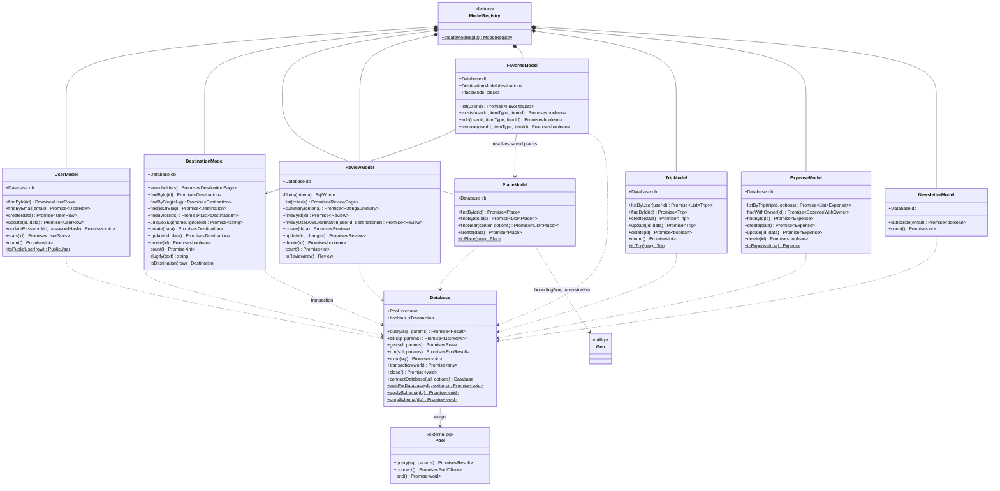
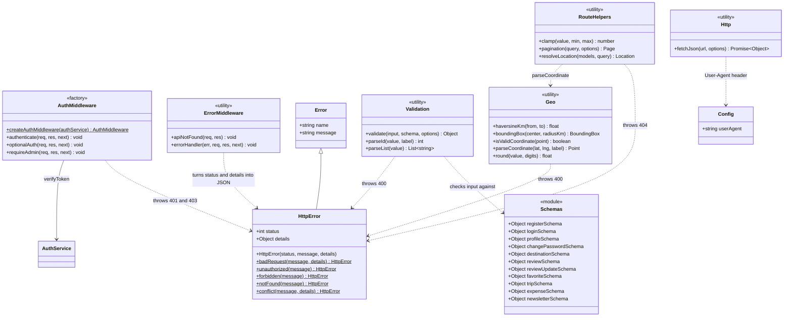

# Class Diagram

*Tripza – Group No-02, Team CodeCrafters · CSE0613316 Software Project Design & Development Lab · [Back to README](../README.md)*

This document shows the static structure of **Tripza** in two views:

1. **Domain model** – the business entities, their attributes and multiplicities (independent of code).
2. **Backend classes** – the real JavaScript classes and modules in `backend/src`, with their public methods, and how `createApp()` wires them together.

Related documents: [UML_DIAGRAMS.md](UML_DIAGRAMS.md) (behaviour, components, ER diagram), [USE_CASES.md](USE_CASES.md), [TEST_CASES.md](TEST_CASES.md).

**Notation used in the backend diagrams**

- `+` public, `-` private (JavaScript `#private` methods).
- Members marked as static (shown underlined, written with `$` in the source) are **module-level exported functions** in the same file, for example `toPublicUser()` in `UserModel.js`.
- Modules that contain only functions are drawn as classes with a stereotype: `«utility»` (stateless helpers), `«factory»` (functions that build and return objects) or `«module»` (a group of exports).
- Parameters named `data`, `options`, `filters`, `criteria`, `changes` or `deps` are a single object argument. Their fields are listed in [Object parameters](#33-object-parameters).

## Contents

1. [Domain model](#1-domain-model)
   - [1.1 Entities and associations](#11-entities-and-associations)
   - [1.2 Enumerations](#12-enumerations)
2. [Backend classes](#2-backend-classes)
   - [2.1 Application wiring](#21-application-wiring)
   - [2.2 Models](#22-models)
   - [2.3 Services](#23-services)
   - [2.4 Middleware, errors and utilities](#24-middleware-errors-and-utilities)
3. [Reference tables](#3-reference-tables)
   - [3.1 Class responsibilities](#31-class-responsibilities)
   - [3.2 Return types](#32-return-types)
   - [3.3 Object parameters](#33-object-parameters)

---

## 1. Domain model

### 1.1 Entities and associations

`Destination.rating`, `Destination.reviewCount` and `Trip.totalSpent` are derived attributes: they are calculated by SQL from `reviews` and `expenses` on every read and are not stored. A trip owns its expenses (composition): deleting a trip deletes them. Deleting a user removes their trips, reviews and favorites; deleting a destination removes its reviews and favorites but keeps places and trips, whose link becomes empty. `NewsletterSubscriber` is deliberately not linked to `User`, because guests can subscribe.

### 1.2 Enumerations

The values come from the constants in the code (`CATEGORIES`, `REGIONS`, `PLACE_CATEGORIES`, `FAVORITE_TYPES`, `CURRENCIES`, `EXPENSE_CATEGORIES`, `TRAVEL_MODES`, `BUDGETS`) and from the `CHECK` constraints in `schema.sql`. `TravelMode`, `BudgetStatus` and `BudgetBand` are not stored; they are used by the route planner, the budget summary and the Explore filter (low is under 500 USD, mid is 500 to 1,500 USD and high is 1,500 USD or more of `avgCost`).

---

## 2. Backend classes

### 2.1 Application wiring

`createApp({ db, config, liveApis, logRequests })` is the composition root. It receives the database connection from outside, so the tests can pass a connection bound to a temporary PostgreSQL schema and `liveApis: false`. It then builds the models, the services and the auth middleware, bundles them into one context object (`ctx`) and hands that to each router factory. Nothing in the backend creates its own dependencies, which keeps every layer replaceable in tests.

### 2.2 Models

Each model wraps one table and is the only place where SQL for that table is written. Every model method is `async` and returns a Promise. All queries are parameterised: models write `?` placeholders, `Database` converts them to PostgreSQL's `$1, $2, …` and passes the values separately, so user input is never concatenated into SQL. Models return camelCase objects built by their `toX()` mappers. `UserModel` is the exception: its methods return the raw row (including `password_hash`) because `AuthService` needs the hash, and every route passes user rows through `toPublicUser()` before sending them.

### 2.3 Services

```mermaid
classDiagram
    class ServiceRegistry {
        <<factory>>
        +createServices(deps) ServiceRegistry$
    }
    class AuthService {
        +UserModel users
        +string jwtSecret
        +string jwtExpiresIn
        +int bcryptRounds
        +hashPassword(password) Promise~string~
        +issueToken(user) string
        +verifyToken(token) UserRow
        +register(data) Promise~AuthResult~
        +login(credentials) Promise~AuthResult~
        +changePassword(userId, currentPassword, newPassword) Promise~void~
    }
    class WeatherService {
        +boolean liveApis
        +int cacheTtlMs
        +Map cache
        -fetchOpenMeteo(point) Promise~Forecast~
        +getForecast(point, options) Promise~WeatherReport~
        +describeWeather(code) Condition$
        +travelSuggestion(current, today) Suggestion$
        +simulatedForecast(point, now) Forecast$
    }
    class RouteService {
        +boolean liveApis
        -fetchOsrm(from, to, mode) Promise~RawRoute~
        +getRoute(from, to, mode) Promise~Route~
        +formatDuration(minutes) string$
        +navigationUrl(from, to, mode) string$
        +estimateRoute(from, to, mode) RawRoute$
    }
    class GeocodeService {
        +DestinationModel destinations
        +boolean liveApis
        -nominatim(query) Promise~List~GeoResult~~
        +search(query, options) Promise~List~GeoResult~~
    }
    class NearbyService {
        +PlaceModel places
        +boolean liveApis
        -overpass(center, options) Promise~List~Place~~
        +find(center, options) Promise~NearbyResult~
    }
    class BudgetService {
        <<utility>>
        +tripLength(startDate, endDate) int
        +daysRemaining(startDate, endDate, today) int
        +summarizeBudget(trip, expenses, today) BudgetSummary
    }
    class BudgetSummary {
        +float budget
        +string currency
        +float totalSpent
        +float remaining
        +float percentUsed
        +BudgetStatus status
        +int days
        +int daysLeft
        +float perDayRemaining
        +int expenseCount
        +List~CategoryTotal~ byCategory
    }
    class Http {
        <<utility>>
        +fetchJson(url, options) Promise~Object~
    }
    class Geo {
        <<utility>>
    }
    class UserModel
    class DestinationModel
    class PlaceModel
    class ExpenseModel

    ServiceRegistry *-- AuthService
    ServiceRegistry *-- WeatherService
    ServiceRegistry *-- RouteService
    ServiceRegistry *-- GeocodeService
    ServiceRegistry *-- NearbyService
    AuthService --> UserModel : users
    GeocodeService --> DestinationModel : destinations
    NearbyService --> PlaceModel : places
    WeatherService ..> Http : Open-Meteo
    RouteService ..> Http : OSRM
    GeocodeService ..> Http : Nominatim
    NearbyService ..> Http : Overpass
    RouteService ..> Geo : haversineKm
    NearbyService ..> Geo : haversineKm
    BudgetService ..> BudgetSummary : returns
    BudgetService ..> ExpenseModel : EXPENSE_CATEGORIES
```

Every service that calls an external API takes a `liveApis` flag and has an offline path: `WeatherService` falls back to `simulatedForecast()`, `RouteService` to `estimateRoute()`, `GeocodeService` to local destinations only, and `NearbyService` uses curated places first and treats an Overpass failure as "no results". `BudgetService` is not in the service registry; it is a set of pure functions imported directly by `routes/trips.js`, which makes it easy to unit test.

### 2.4 Middleware, errors and utilities

Route handlers never build error responses themselves: they throw an `HttpError` (or let `validate()` throw one) and Express 5 forwards it, including errors from `async` handlers, to `errorHandler`. The handler sends `{ error: { message, details } }` with the right status, returns 400 for malformed JSON and 413 for bodies over 1 MB, and replaces any 5xx message with a generic one so internal details are not leaked.

---

## 3. Reference tables

### 3.1 Class responsibilities

| Class / module | File | Responsibility |
| --- | --- | --- |
| `AppFactory` | `src/app.js` | `createApp()` builds the Express app: creates models, services and auth middleware, adds helmet security headers, CORS, JSON body parsing (1 MB limit) and request logging, mounts every router under `/api`, serves `frontend/dist` when it exists and registers the error handler last. |
| `AppContext` | `src/app.js` (`ctx`) | Plain object `{ db, models, services, auth, config, liveApis }` passed to every router factory. |
| `Config` | `src/config.js` | Reads environment variables with defaults: port 4000, JWT secret and expiry (`7d`), bcrypt rounds (10), PostgreSQL connection URL (`DATABASE_URL`), CORS origin, `LIVE_APIS`, frontend build path, User-Agent for external APIs. |
| `Database` | `src/db/database.js` | Wraps a `pg` connection pool: `all()`, `get()`, `run()` and `exec()` with `?` placeholders; `transaction()` runs work on one client inside `BEGIN`/`COMMIT` with rollback on error. `connectDatabase()` opens the pool, `waitForDatabase()` retries until the Docker container accepts connections, `applySchema()` creates missing tables and `dropSchema()` removes them for a fresh seed. Type parsers return counts and NUMERIC values as numbers and DATE columns as `YYYY-MM-DD` strings. |
| `ModelRegistry` | `src/models/index.js` | `createModels(db)` creates one instance of each model on the same connection and injects `DestinationModel` and `PlaceModel` into `FavoriteModel`. |
| `UserModel` | `src/models/UserModel.js` | Users table: find by id or email, create, update profile, replace password hash, count trips/favorites/reviews for the profile, count users. `toPublicUser()` removes `password_hash`. |
| `DestinationModel` | `src/models/DestinationModel.js` | Destination search with text query, category, region, budget band and minimum rating filters, seven sort orders and pagination; average rating and review count from `reviews`; unique slug generation; create, update and delete (delete also removes favorites in one transaction). |
| `PlaceModel` | `src/models/PlaceModel.js` | Curated nearby places: lookup by id, and `findNear()` which pre-filters by bounding box in SQL and then by exact great-circle distance, sorted by distance or rating. |
| `ReviewModel` | `src/models/ReviewModel.js` | Review list with reviewer and destination names, rating summary (average, count, percentage per star), lookup of a user's review for a destination, create, update, delete. |
| `FavoriteModel` | `src/models/FavoriteModel.js` | Polymorphic bookmarks for destinations and places; `add()` is idempotent (`INSERT OR IGNORE`) and `list()` resolves the saved ids to full objects, newest first. |
| `TripModel` | `src/models/TripModel.js` | Trips with destination name, slug and image and the total spent; ordered by start date. |
| `ExpenseModel` | `src/models/ExpenseModel.js` | Expenses of a trip, optionally filtered by category; `findWithOwner()` joins the trip to check ownership. |
| `NewsletterModel` | `src/models/NewsletterModel.js` | Idempotent newsletter subscription (case-insensitive email) and subscriber count. |
| `ServiceRegistry` | `src/services/index.js` | `createServices()` builds the five services with the models, config values and `liveApis` flag. |
| `AuthService` | `src/services/AuthService.js` | Password hashing with bcrypt, JWT issue and verification, register (409 on duplicate email), login (generic 401 message), change password (checks the current one). |
| `WeatherService` | `src/services/WeatherService.js` | Current weather and 7-day forecast from Open-Meteo, 10-minute in-memory cache, deterministic simulated forecast as fallback, WMO code descriptions and a travel suggestion (good, caution or alert). |
| `RouteService` | `src/services/RouteService.js` | Route by car, bus or walking from OSRM, with a straight-line estimate as fallback; readable duration, notes and a Google Maps directions URL. |
| `GeocodeService` | `src/services/GeocodeService.js` | Place search for the route planner: Tripza destinations whose name matches first, then OpenStreetMap Nominatim results (cities, addresses) when online. |
| `NearbyService` | `src/services/NearbyService.js` | Nearby places: curated places first, OpenStreetMap Overpass API only when none are in range and live APIs are on. |
| `BudgetService` | `src/services/BudgetService.js` | Pure functions: trip length, days remaining and the budget summary (totals, percent used, status thresholds 80% and 100%, per-day allowance, spending by category). |
| `AuthMiddleware` | `src/middleware/auth.js` | `createAuthMiddleware()` returns `authenticate` (requires a valid Bearer token, sets `req.user`), `optionalAuth` (sets `req.user` if a valid token is sent) and `requireAdmin` (403 unless role is admin). |
| `ErrorMiddleware` | `src/middleware/errorHandler.js` | JSON 404 for unknown `/api` routes; maps thrown errors to JSON responses with the right status. |
| `HttpError` | `src/utils/errors.js` | `Error` subclass carrying an HTTP status and optional field `details`; helpers `badRequest`, `unauthorized`, `forbidden`, `notFound`, `conflict`. |
| `Validation` | `src/utils/validate.js` | Schema-based request validation: trims strings, coerces numbers, lowercases emails, applies defaults, drops unknown fields and reports every invalid field at once; `partial` mode for updates. |
| `Schemas` | `src/routes/schemas.js` | Validation rules for every request body (lengths, ranges, enums, date and URL formats, password strength). |
| `RouteHelpers` | `src/routes/helpers.js` | `pagination()` (default 12, max 50 per page), `clamp()`, and `resolveLocation()` which turns `?destination=` or `?lat=&lng=` into a point. |
| `Geo` | `src/utils/geo.js` | Haversine distance, bounding box, coordinate validation and parsing (`"lat,lng"` strings), rounding. |
| `Http` | `src/utils/http.js` | `fetchJson()` for external APIs with timeout (default 6 s), Tripza User-Agent and error on non-2xx responses. |
| `RouteModules` | `src/routes/*.js` | Eleven router factories, one per resource, each receiving `ctx` and returning an Express `Router`. |

### 3.2 Return types

| Type | Fields |
| --- | --- |
| `UserRow` | Raw `users` row: `id, name, email, password_hash, role, location, bio, created_at` |
| `PublicUser` | `id, name, email, role, location, bio, createdAt` (no password hash) |
| `UserStats` | `trips, favorites, reviews` |
| `AuthResult` | `token, user` (a `PublicUser`) |
| `DestinationPage` | `items` (list of `Destination`), `total` |
| `ReviewPage` | `items` (list of `Review`), `total` |
| `RatingSummary` | `average` (1 decimal), `count`, `distribution` (percent per star, 5 to 1) |
| `FavoriteLists` | `destinations`, `places` (each item has `savedAt`) |
| `ExpenseWithOwner` | `expense`, `ownerId` |
| `NearbyResult` | `items` (places with `distanceKm`), `source` (`tripza` or `openstreetmap`) |
| `GeoResult` | `name, label, lat, lng, type` (`destination` or `place`), `slug` for destinations |
| `Forecast` | `current, daily` (7 days), `timezone` |
| `WeatherReport` | `location, current, today, daily, suggestion, source` (`open-meteo` or `simulated`), `fetchedAt` |
| `Condition` | `condition, icon` |
| `Suggestion` | `level` (`good`, `caution`, `alert`), `title, text` |
| `RawRoute` | `distanceKm, durationMin, geometry, via, source` (`openstreetmap` or `estimate`) |
| `Route` | `mode, from, to, distanceKm, durationMin, durationText, via, geometry, notes, source, navigationUrl` |
| `CategoryTotal` | `category, amount, percent` |

### 3.3 Object parameters

| Method | Object fields (defaults in brackets) |
| --- | --- |
| `createApp(options)` | `db`, `config` [config.js], `liveApis` [config.liveApis], `logRequests` [true] |
| `createServices(deps)` | `models`, `config`, `liveApis` |
| `new AuthService(deps)` | `users`, `jwtSecret`, `jwtExpiresIn` ["7d"], `bcryptRounds` [10] |
| `AuthService.register(data)` | `name`, `email`, `password` |
| `AuthService.login(credentials)` | `email`, `password` |
| `new WeatherService(options)` | `liveApis` [true], `cacheTtlMs` [600000] |
| `WeatherService.getForecast(point, options)` | point: `lat`, `lng`; options: `name` |
| `RouteService.getRoute(from, to, mode)` | `from`, `to`: `lat`, `lng`; `mode` ["car"] |
| `GeocodeService.search(query, options)` | `limit` [8] |
| `NearbyService.find(center, options)` | center: `lat`, `lng`; options: `radiusKm` [5], `category`, `sort` ["distance"], `limit` [20] |
| `DestinationModel.search(filters)` | `q`, `categories` [], `regions` [], `budgets` [], `minRating` [0], `sort` ["recommended"], `limit` [12], `offset` [0] |
| `DestinationModel.create(data)` / `update(id, data)` | `name, location, country, region, category, tag, summary, description, imageUrl, gallery, latitude, longitude, bestTime, entryFee, openingHours, gettingThere, localTip, avgCost` |
| `PlaceModel.findNear(center, options)` | `radiusKm` [5], `category`, `sort` ["distance" or "rating"], `limit` [20] |
| `PlaceModel.create(data)` | `destinationId, name, category, type, address, phone, latitude, longitude, rating` |
| `ReviewModel.list(criteria)` | `destinationId`, `userId`, `limit` [20], `offset` [0] |
| `ReviewModel.summary(criteria)` | `destinationId`, `userId` |
| `ReviewModel.create(data)` | `userId, destinationId, rating, comment`, `createdAt` [now] |
| `ReviewModel.update(id, changes)` | `rating`, `comment` |
| `UserModel.create(data)` | `name, email, passwordHash`, `role` ["user"], `location`, `bio` |
| `UserModel.update(id, data)` | `name, location, bio` |
| `TripModel.create(data)` / `update(id, data)` | `userId` (create only), `destinationId, name, startDate, endDate, budget`, `currency` ["USD"] |
| `ExpenseModel.listByTrip(tripId, options)` | `category` |
| `ExpenseModel.create(data)` / `update(id, data)` | `tripId` (create only), `title, category, amount, spentOn, note` |
| `validate(input, schema, options)` | `partial` [false] |
| `pagination(query, options)` | `defaultLimit` [12], `maxLimit` [50] |
| `fetchJson(url, options)` | `timeoutMs` [6000], `method` ["GET"], `headers`, `body` |
