# UML Diagrams

*Tripza – Group No-02, Team CodeCrafters · CSE0613316 Software Project Design & Development Lab · [Back to README](../README.md)*

This document holds the behavioural and structural UML diagrams for **Tripza – A Tourism and Travel Exploration System**. The diagrams were drawn from the backend source code (`backend/src`, Node.js 22 + Express 5 + PostgreSQL via `pg`) and the planned React frontend routes. Class names, method names, endpoints and tables are the real ones from the code. Class diagrams are in [CLASS_DIAGRAM.md](CLASS_DIAGRAM.md), use case specifications are in [USE_CASES.md](USE_CASES.md), and test cases are in [TEST_CASES.md](TEST_CASES.md).

All diagrams use Mermaid, so GitHub renders them directly.

## Contents

1. [Use case diagram](#1-use-case-diagram)
2. [Activity diagrams](#2-activity-diagrams)
   - [2.1 Plan a trip end to end](#21-plan-a-trip-end-to-end)
   - [2.2 Record an expense](#22-record-an-expense)
3. [Sequence diagrams](#3-sequence-diagrams)
   - [3.1 Register an account](#31-register-an-account)
   - [3.2 Log in and call a protected endpoint with a JWT](#32-log-in-and-call-a-protected-endpoint-with-a-jwt)
   - [3.3 Explore and view a destination](#33-explore-and-view-a-destination)
   - [3.4 Nearby search with Overpass fallback](#34-nearby-search-with-overpass-fallback)
   - [3.5 Weather with caching and Open-Meteo fallback](#35-weather-with-caching-and-open-meteo-fallback)
   - [3.6 Route planning with OSRM fallback](#36-route-planning-with-osrm-fallback)
   - [3.7 Add an expense and refresh the budget summary](#37-add-an-expense-and-refresh-the-budget-summary)
   - [3.8 Write a review](#38-write-a-review)
4. [State machine diagrams](#4-state-machine-diagrams)
   - [4.1 Budget status](#41-budget-status)
   - [4.2 Trip lifecycle](#42-trip-lifecycle)
5. [Component diagram](#5-component-diagram)
6. [Deployment diagram](#6-deployment-diagram)
7. [Entity relationship diagram](#7-entity-relationship-diagram)

---

## 1. Use case diagram

Mermaid has no native use case diagram, so it is drawn as a flowchart: actors on the left, use cases (stadium shapes) inside the system boundary, and external systems on the right. Dashed arrows are `«include»` and `«extend»` relationships.

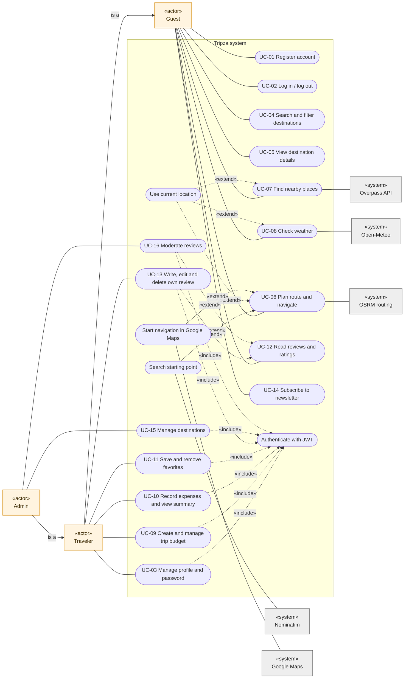

A Traveler can do everything a Guest can, and an Admin everything a Traveler can ("is a" arrows show actor generalisation). Every personal or admin use case includes JWT authentication, while the location helpers and Google Maps hand-off are optional extensions of the routing, nearby and weather use cases.

---

## 2. Activity diagrams

### 2.1 Plan a trip end to end

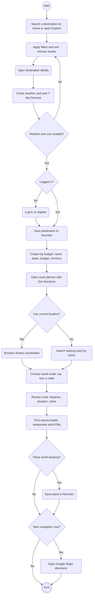

This is the main journey the proposal describes: discover a destination, check the weather, bookmark it, set a budget, plan the route and look up services around it. Login is only requested at the first step that stores personal data.

### 2.2 Record an expense

Blue nodes are traveler actions, green nodes are web app actions and orange nodes are API actions.

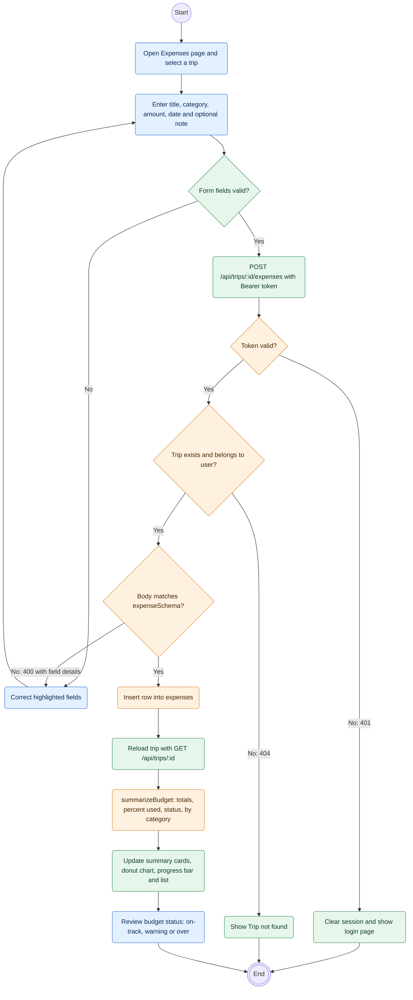

Validation happens twice: in the form for quick feedback and in the API (`validate(body, expenseSchema)`), which is the authority. The budget status is recalculated after every change rather than stored.

---

## 3. Sequence diagrams

### 3.1 Register an account

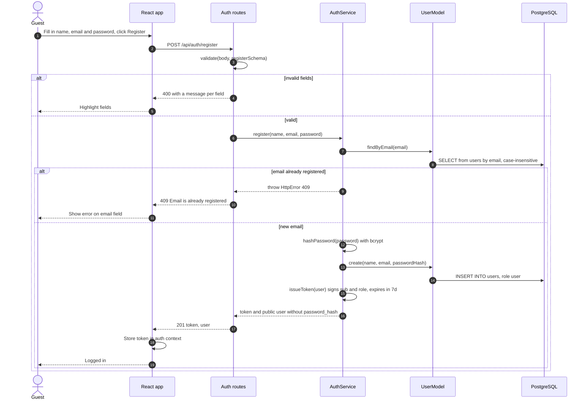

Registration signs the user in straight away by returning a JWT. The password is hashed with bcrypt before storage and the response is built with `toPublicUser()`, so the hash never leaves the server.

### 3.2 Log in and call a protected endpoint with a JWT

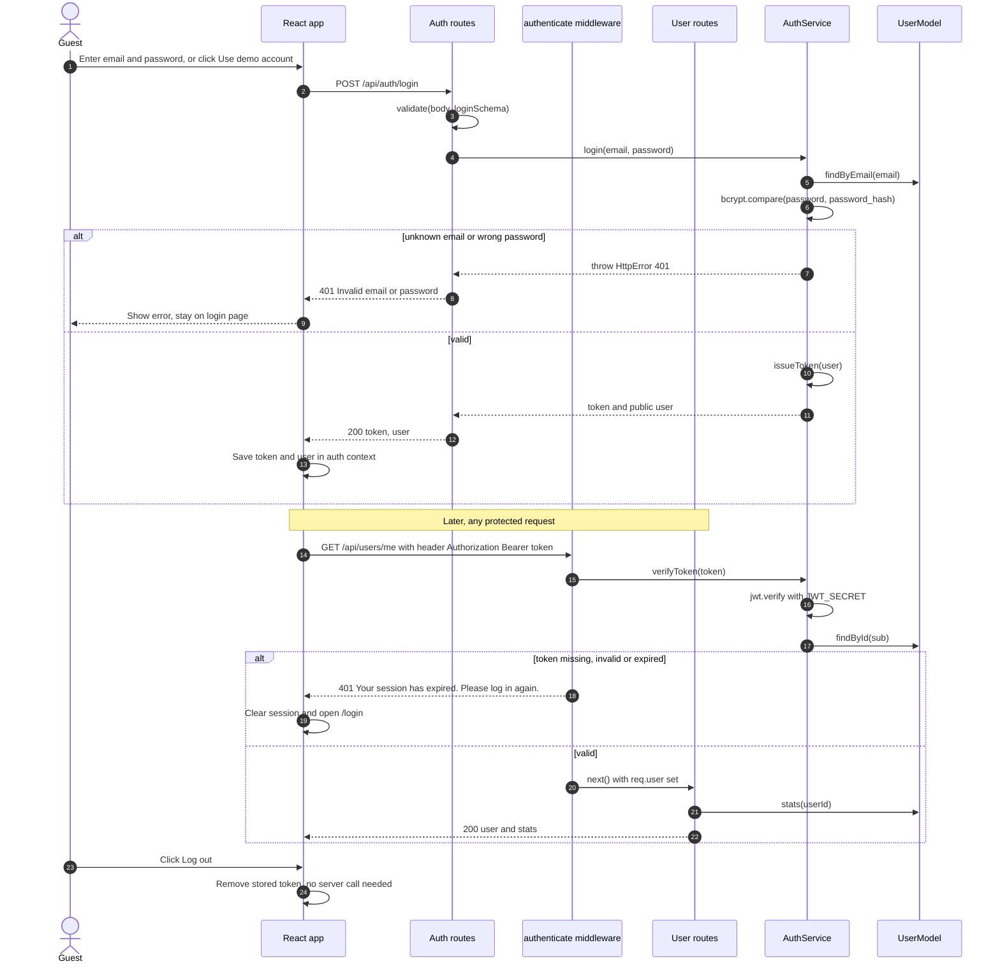

The same message is returned for an unknown email and a wrong password, so attackers cannot find out which emails are registered. JWTs are stateless: the server only checks the signature and expiry (`JWT_EXPIRES_IN`, default 7 days), and logging out means the client discards the token.

### 3.3 Explore and view a destination

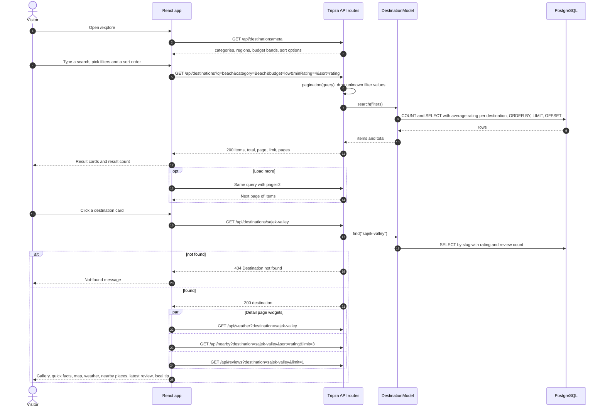

The rating and review count are never stored on the destination; they are calculated with a `LEFT JOIN` over `reviews` on every query, so they are always current. The detail page loads its widgets in parallel once the destination itself is known.

### 3.4 Nearby search with Overpass fallback

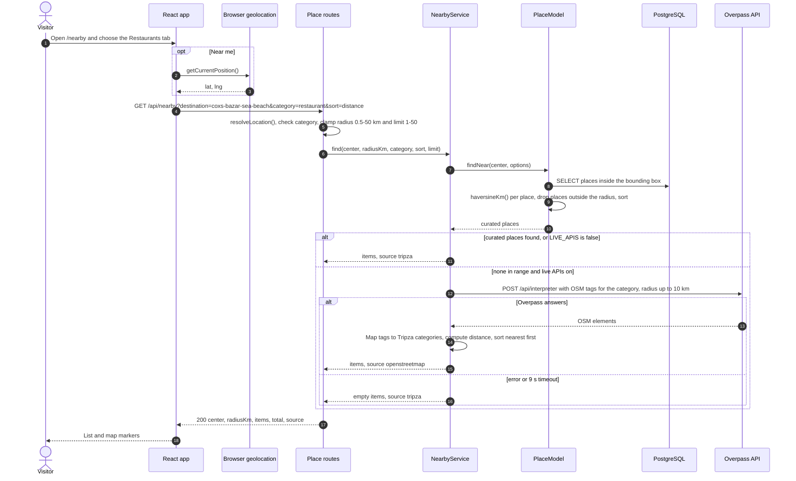

Tripza's own curated places are always preferred; OpenStreetMap is only asked when there are none in range, and a failure there still returns an empty result instead of an error. Places from OpenStreetMap have ids such as `osm-node-123`, so they cannot be saved as favorites.

### 3.5 Weather with caching and Open-Meteo fallback

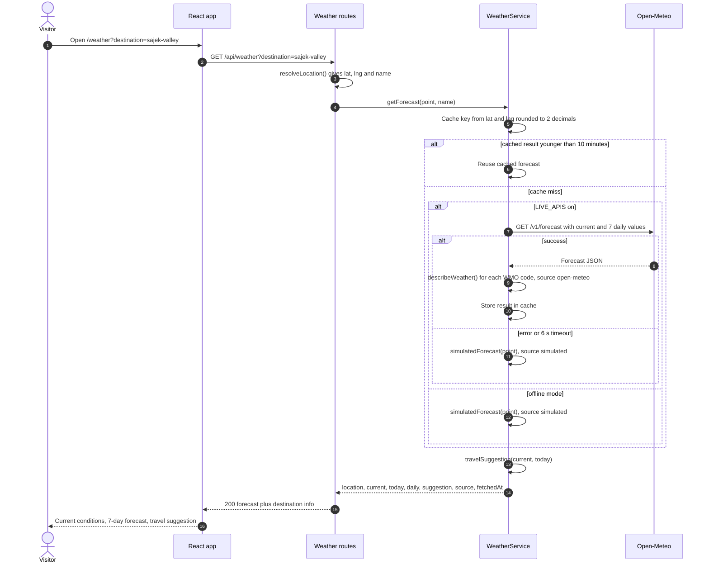

Live results are cached in memory for 10 minutes per rounded coordinate (about 1 km), so repeated views of the same place do not call Open-Meteo again. Simulated forecasts are deterministic and never cached, so the live API is tried again on the next request.

### 3.6 Route planning with OSRM fallback

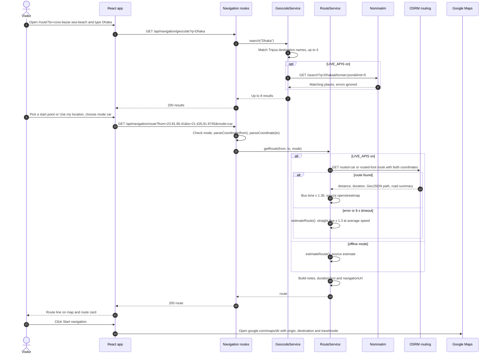

The fallback estimate uses the great-circle distance times 1.3 and average speeds of 45 km/h (car), 30 km/h (bus) and 4.8 km/h (walk), so the planner always gives an answer. Turn-by-turn navigation is handed to Google Maps through a deep link, which needs no API key.

### 3.7 Add an expense and refresh the budget summary

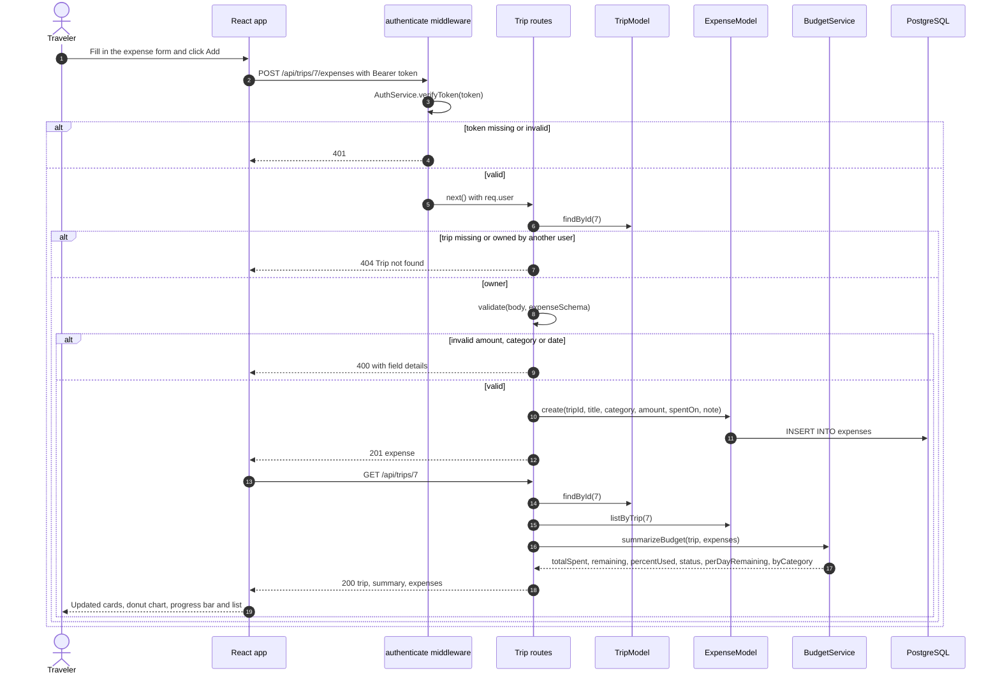

Another user's trip returns 404 rather than 403, so the API does not reveal that the trip exists. `summarizeBudget()` is a pure function, which is why it can be unit tested without a database (TC-UNIT-01 to TC-UNIT-03).

### 3.8 Write a review

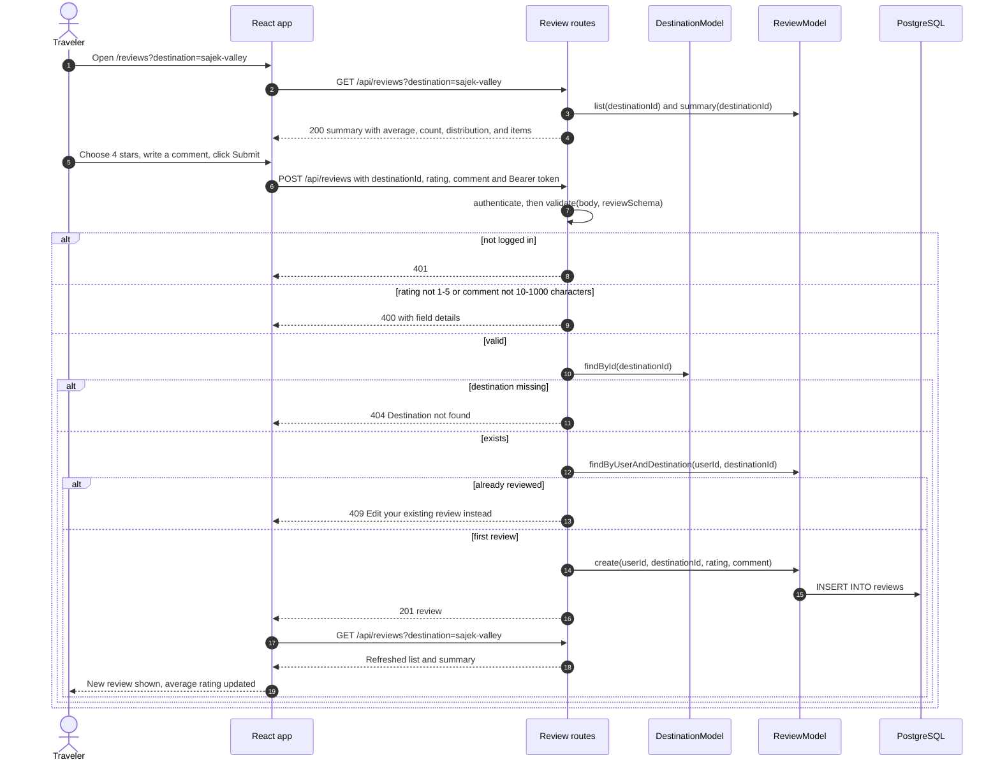

Each traveler may review a destination once (also enforced by `UNIQUE (user_id, destination_id)` in the database); later changes go through `PUT /api/reviews/:id`. Only the author may edit a review, while the author or an admin may delete it.

---

## 4. State machine diagrams

### 4.1 Budget status

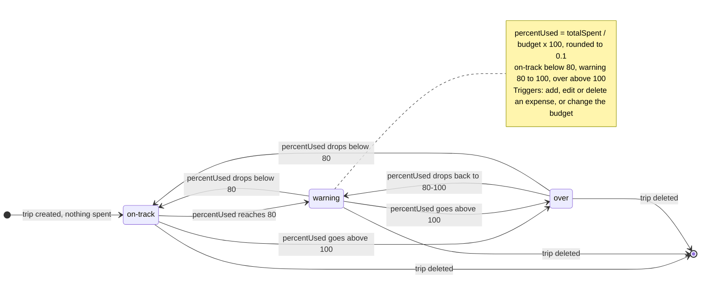

The status comes from `summarizeBudget()` in `BudgetService.js` (`percentUsed > 100` gives `over`, `percentUsed >= 80` gives `warning`, otherwise `on-track`). It is recalculated on every trip read and never stored; spending exactly 100% of the budget is still `warning`, and a trip with a budget of 0 and some spending counts as 100%.

### 4.2 Trip lifecycle

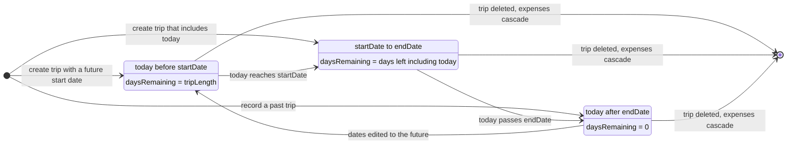

The trip state is derived from `startDate`, `endDate` and today's date; it is not a database column. `daysRemaining()` in `BudgetService` uses the same boundaries, and the profile page uses the state to list upcoming trips. Editing the dates re-evaluates the state, so any state can move to any other.

---

## 5. Component diagram

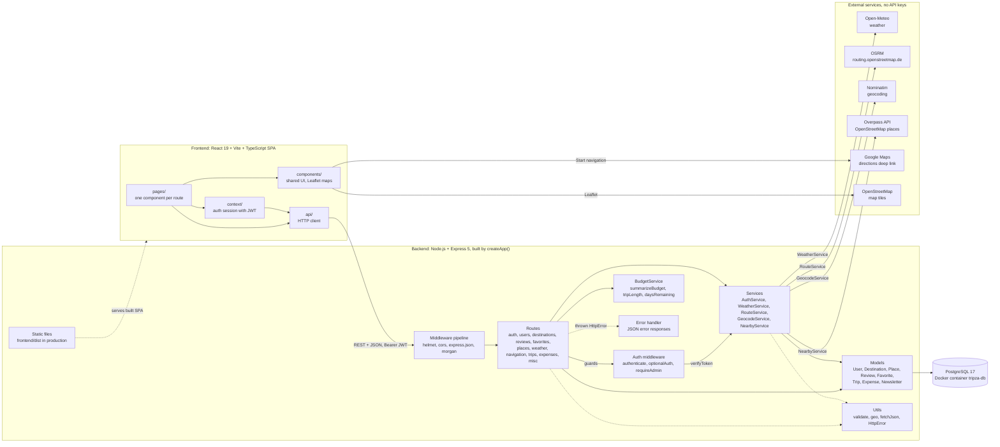

The backend is layered: routes validate input and check access, services hold business logic and external API calls, and models are the only code that runs SQL. Simple CRUD routes (destinations, favorites, reviews, trips, expenses) call models directly, while authentication and all external lookups go through services.

---

## 6. Deployment diagram

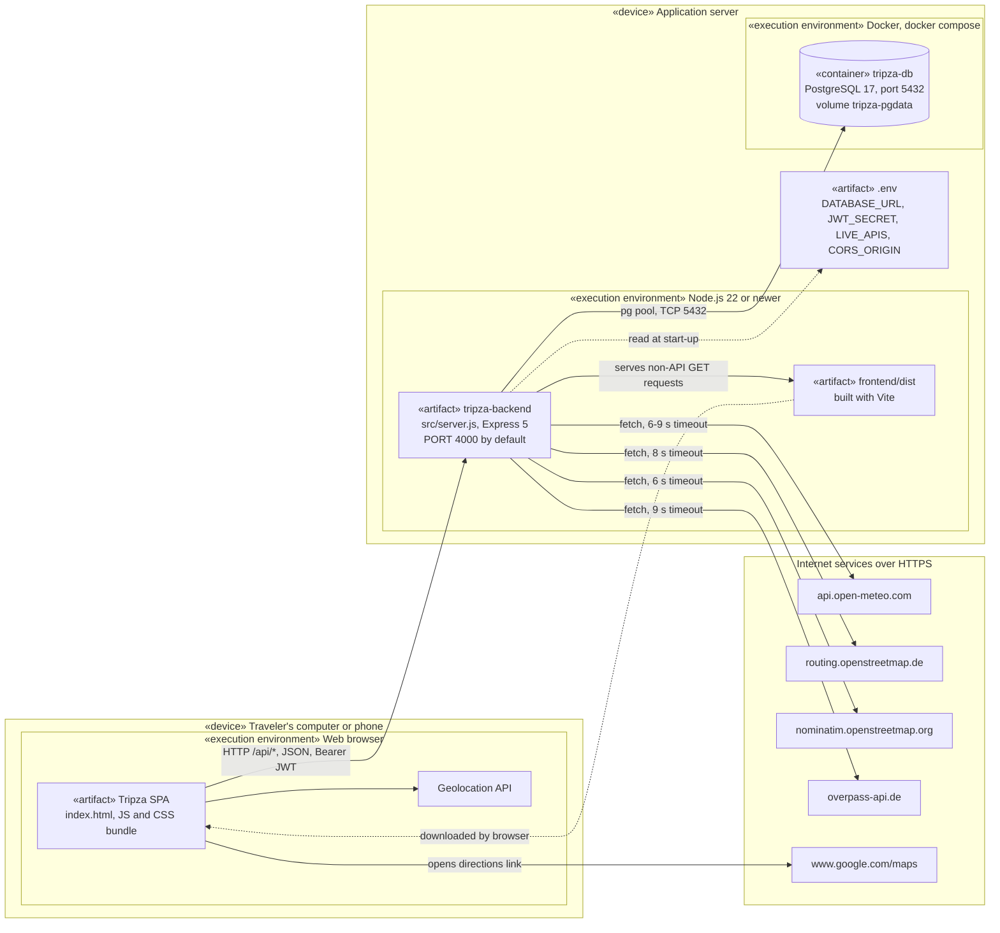

In production a single Node.js process serves both the REST API and the built frontend from `frontend/dist`, and PostgreSQL runs in a Docker container started with `docker compose up -d` (data is kept in the `tripza-pgdata` volume). The API creates any missing tables at start-up and seeds an empty database; `npm run seed` drops and recreates the tables with fresh sample data. During development the Vite dev server serves the frontend and calls the API on port 4000 (`CORS_ORIGIN` controls which origins are allowed); setting `LIVE_APIS=false` removes all outbound calls.

---

## 7. Entity relationship diagram

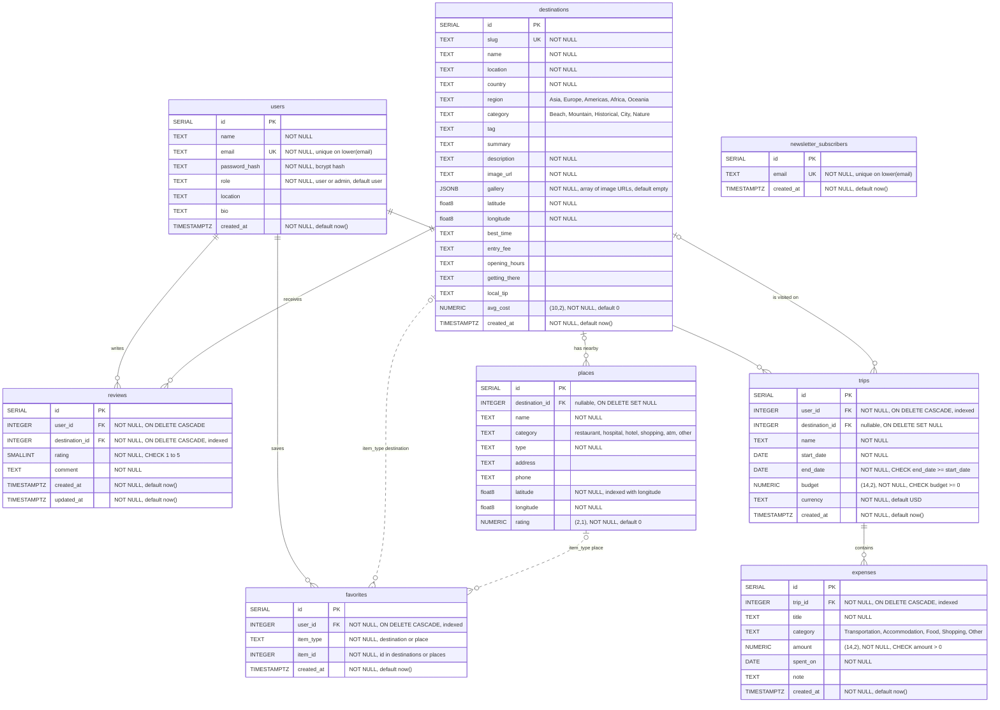

This matches `backend/src/db/schema.sql` table for table. Two composite unique constraints are not visible in the diagram: `reviews UNIQUE (user_id, destination_id)` (one review per traveler per destination) and `favorites UNIQUE (user_id, item_type, item_id)` (an item is saved once). The dotted `favorites` links are polymorphic (`item_type` + `item_id`) and not enforced by a foreign key; `DestinationModel.delete()` removes matching favorites in the same transaction.
